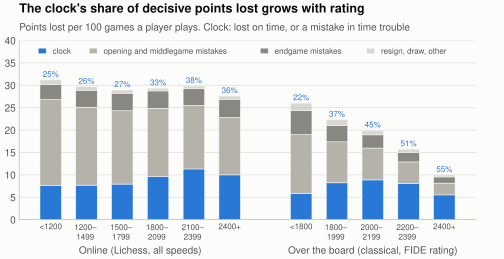
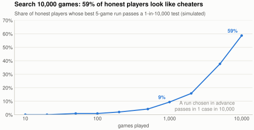

# chesslab

Tiny experiments in chess.

### [Where are chess games lost?](experiments/decided)

Mostly to plain mistakes. But the higher the rating, the more the clock decides: over the board at
2400+, it costs 55% of the points lost.

[](experiments/decided)

### [Does more clock at move 20 go with better results?](experiments/clock)

Yes, a little. In classical chess, reaching move 20 with 10% more of your time goes with about +8 Elo.
For players who are usually short of time by then, it goes with +14.

### [Do textbook endgame rules hold under perfect play?](experiments/endgames)

Mostly, but not at the edges. The rule of five calls sum 5 a draw, yet 62% of those positions are
wins.

| rule of five | 3 | 4 | 5 | 6 | 7+ |
| --- | --- | --- | --- | --- | --- |
| White wins | 9% | 23% | **62%** | 96% | 100% |

### [Does thinking at the right moments make you better?](experiments/thinking)

Not measurably. Over a year, players who spend their time on the right moves gain no more rating than
others.

### [Can statistics catch a chess cheater?](experiments/cheating)

Only a heavy one. Honest players of the same rating differ so much that a cheater who uses the engine
once a game is caught less than half the time. And everyone has hot streaks: pick the best 5 games of
an honest player with 10,000 games, and in 59% of cases they look like proof of cheating.

[](experiments/cheating)

## Run it

```sh
make quick   # redraw the charts, in seconds
make data    # download the data, about 19 GB
make all     # rerun everything, about 8 hours
```

It requires Linux, [uv](https://docs.astral.sh/uv/), make and a C compiler.

## Data

Games from the [Lichess database](https://database.lichess.org), ratings from
[FIDE](https://ratings.fide.com), endgames from the [Syzygy tables](https://tablebase.lichess.ovh)
and analysis by [Stockfish](https://stockfishchess.org).

## License

GPL 3.0 or later. Fathom, in `fathom/`, is MIT.
