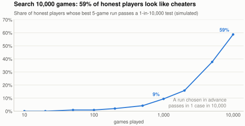

# Can statistics catch a chess cheater?

Only a heavy one: honest players of the same rating differ by 0.24 mistakes per game, so a cheater
who removes fewer than about 0.9 mistakes per game is flagged less than half the time by a test that
flags 1 honest player in 10,000, however many games he plays.

Let the test also catch 9 cheaters in 10. An engine that fixes the worst move of each game never
gets there; one that fixes the 2 or 3 worst moves needs 36 to 1,017 games below 2400 and never gets
there from 2400 (fixing 2: from 2200); one asked at 1 to 3 random critical moments over the board
needs 123 to 6,219 games even if players did not differ. The chart shows the reverse trap: the best
run of an honest player, tested as if it had been chosen in advance, looks like proof. All cheaters
here are simulated with a simple model.

## Reproduce

    make data            # once, from the repo root
    make cheating        # about 8 min, one heavy job
    make -C experiments/cheating quick   # the chart from results/, seconds

## Method

- Data: the Lichess broadcast of Sep 2026, all events, both ratings 1000-2900, at least 30 plies,
  at most 2 plies without an eval: 20,754 games, 40,960 player-games, 30,230 of them classical
  (first clock at least 50 min) (`sample.csv`).
- A move from ply 16 on loses the drop in the mover's win%, from the Lichess eval in the PGN and the
  Lichess formula (eval clipped to ±10 pawns). Moves in decided positions (win% ≤ 3 or ≥ 97) do not
  count. A mistake loses at least 10 win%. A player-game needs 10 judged moves.
- Honest baseline: mistakes per classical game, by 200-point rating band (`honest_mistakes.csv`):
  2.83 at 1400, 2.27 at 1800, 1.51 at 2200, 0.80 at 2600.
- Spread: mistakes per game are adjusted for rating, rating squared, the rating gap to the opponent
  and the number of judged moves. The between-player SD comes from the method of moments over the
  2,501 players (FIDE ID, else name) with at least 6 classical games, 8.2 games each on average;
  95% CI from 300 bootstrap samples of players: 0.239 (0.180-0.284) (`spread.csv`).
- Test: a player's mean mistakes per game against the honest mean at his rating, one-sided, at a
  false-positive rate of 1e-4 and 90% power. Its null variance is σ_w²/N + σ_b², so with many games
  the threshold tends to 3.72 × σ_b = 0.89 mistakes per game.
- Model A (online): the cheater sees the engine on every move and overrides his k worst moves of each
  game, so m mistakes become max(m − k, 0) (`model_a.csv`).
- Model B (over the board): Stockfish 19 (30,000 nodes, the 2 best moves, Hash 64) judges every
  position from ply 16 of 420 classical games, 60 per 200-point band of average rating 1400-2799,
  rating gap ≤ 300. A critical moment: the best move keeps 10-90 win% and is at least 10 win%
  better than the second best. The cheater asks the engine at k random critical moments of a game;
  the statistic is critical moments missed per game (`model_b.csv`).
- Cherry-picking: per-game loss per move drawn from the 13,224 classical player-games at 2000-2399.
  For 1,000 simulated honest players per number of games, the best 5-game run gets a naive p-value
  against 4 million 5-game runs chosen in advance (`cherry_picking.csv`). The median naive p is
  about 1 / games: 9.1e-4 at 1,000 games, 7.9e-5 at 10,000.
- Related work: Regan's model of move choice, used by FIDE; Turk & Polson 2026, signatures of play
  and an anytime-valid sequential test (arXiv 2606.18544); ChessFraud (KDD 2026,
  doi 10.1145/3770855.3817587); Keren 2026, the selective cheater of model A (arXiv 2601.05386).

## Limits

- The model is simple and the cheaters are simulated: one statistic (mistakes per game) and two
  fixed cheating rules; real detectors use more signals and real cheaters other rules.
- The spread comes from about 8 games per player, and part of it may be rating noise (a rating lags
  a player's form).
- The cheater of model A knows his worst moves; a real one fixes fewer mistakes per consultation,
  so he is harder to catch.
- Model B rests on 107 to 134 player-games per band: its numbers are rough.
- Platforms have more data than moves: clock use, behaviour and many more games per player.
