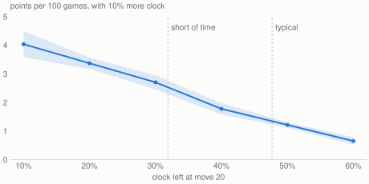

# Does more clock at move 20 go with better results?

Yes, a little. In a 90+30 game, reaching move 20 with 11 more minutes goes with about +8 Elo. For
players who are usually short of time by then, it goes with +14: they are the ones who end up in time
trouble. Both numbers count the small cost of playing faster early. The data are observational, so
these are comparisons within players, not proof.

The less time is left, the more extra time goes with (before the cost of playing faster early):

## Findings

Points per 100 games with 10% more of the budget, with 95% CI. Gross is before the early cost, net after it.

| | gross | net |
|---|---|---|
| over the board, all players | +1.57 (1.51 to 1.64) | +1.15 (0.95 to 1.34) |
| over the board, habitually short | +2.38 (2.30 to 2.46) | +1.95 (1.75 to 2.15) |
| online blitz, all / habitually short | +4.54 / +5.45 | +2.40 (1.32 to 3.48) / +3.36 |
| online rapid, all / habitually short | +1.78 / +2.23 | +0.80 (-1.40 to 3.00) / +1.27 |

- The gross value falls steeply with the clock left: +4.0 points per 100 games at 10% left, +1.2 at 50%.
- Time trouble after move 20 falls 11 points (base 55%). Online blitz: losses on time fall 5.7 points
  (base 12.3%).
- Book-depth instrument: +1.03 (0.36 to 1.70), 0.65 times the regression on the same sides (+1.59).
- Late arrival: losing 10% of the budget before move 1 goes with 0.95 fewer points (0.53 to 1.36);
  by move 20 players have won back 39% of the lost time.
- 60+30 against 90+30 (4,417 players): time trouble 49.6% to 57.2%; result-changing errors unchanged
  (+0.00 points, -0.82 to +0.82).

## Reproduce

    make data            # once, from the repo root
    make clock           # about 2.5 h, one heavy job (Stockfish takes 2 h)
    make -C experiments/clock quick   # the chart from results/, seconds

## Method

- Data: Lichess broadcasts of over-the-board games, Jul 2024 - Oct 2026: classical games with clocks and
  evals on at least 90% of plies and clocks to the second; 695,509 sides at move 20 from 45,833 FIDE players
  with two or more of them. Online: the Lichess Oct 2026 sample, blitz and rapid, without berserk games.
- Budget B = base + 40 × increment. Over the board, the base, increment and time added at move 40 are read
  from the relay clocks, per event. Clock left = (clock after the side's 20th move + 20 × increment) / B.
- Model G, within player (player fixed effects, errors clustered by player): score minus the Elo expectation
  on a linear spline of the clock left (knots 10, 25, 40, 55%), the win chance after move 20 (broadcast eval;
  online, the Lichess eval or Stockfish 19 at 3,000 nodes), the opponent's clock, ratings, position
  complexity, time control, and month and round (over the board) or hour (online). Gross value: the change of
  expected score from +10% of B. The same model gives the change of time trouble (a move with less than 10%
  of B left) and of losses on time.
- Habitually short: players with 10 or more sides whose median clock left is in the lowest fifth of such
  players (3,673 players; median 32% left, time trouble in 81% of games; all players: median 48%).
- Early cost: the time control (log B) is the instrument for the minutes used on moves 1-20; this gives the
  win chance lost per minute saved. Time controls with 2,000 sides or more; online, 3+0, 5+0, 3+2, 5+3
  (blitz) and 10+0, 15+0, 10+5, 15+10 (rapid) with Lichess evals. The within-player slope of score on own
  errors turns win chance into score. Net = gross - early cost; its CI takes the error of all three
  estimates, by player (delta method).
- Checks over the board: book depth (own moves along a line that the player reached before with the same
  colour) as an instrument for the clock left; late arrival (clock lost before move 1); 60+30 against 90+30
  for the same players.

## Limits

- Observational data: players who keep clock may be in better form or have easier positions. The model holds
  the position at move 20 fixed, so the gross value is an upper bound for the value of saving time early.
- The book-depth instrument gives 0.65 times the regression: the regression likely overstates the value.
- The early-cost correction was chosen after the results were seen; the first, planned estimate had the
  wrong sign. Its instrument also changes the event: shorter controls are often other events.
- Games that end before move 20 are left out. Relay clocks are noisy.
- A confirmation on fresh data (the next season, the same code) is needed before any advice.
