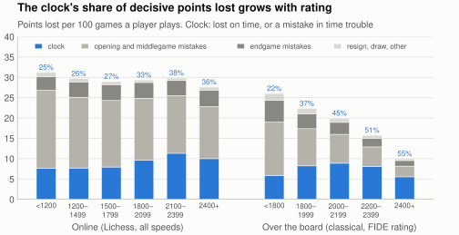

# Where are chess games won and lost?

Mostly by mistakes in the opening and middlegame, but the clock's share grows with rating: online
from 25% of decisive points lost below 1200 to 38% at 2100–2399, over the board from 45% at
2000–2199 to 55% at 2400+.

Stronger players lose far fewer points to opening and middlegame mistakes, but about as many or
more to the clock. The evals are Lichess's own, and the online games with evals are
self-selected; see Limits.

- Endgames with six pieces or fewer decide 1.5% of online games and 1.0% of over-the-board
  classical games.
- Off-board decisions settle 11.4% of online blitz games (bullet 27.4%, rapid 6.5%,
  over-the-board classical 4.1%).
- After an opponent's blunder, the reply is itself a blunder 2.13× as often as usual in online
  blitz and 3.38× in over-the-board classical; after your own blunder, 1.85× (online blitz).
- An opponent's blunder goes unpunished on the next move in 39% of online blitz games below 1200
  and 28% at 2400+ (within three moves: 58% and 44%); over the board, 27% below 1800 and 16% at
  2400+.
- Online, 4.0% of blitz resignations (4.2% over all speeds) come in positions that are not lost;
  a deeper Stockfish search agrees for 126 of 150. In
  [wFxi2JL6](https://lichess.org/game/wFxi2JL6) the 1912 player resigned a tablebase-drawn rook
  endgame with 128 s left.

## Reproduce

    make data            # once, from the repo root
    make decided         # about 35 min, one heavy job
    make -C experiments/decided quick   # the chart from results/, seconds

## Method

- Data: the 316,562 games of the Lichess sample (Oct 2026) with an eval on at least 95% of
  plies, and the 427,382 over-the-board classical broadcast games with evals (Jul 2024 – Oct 2026).
- Each position is won, drawn or lost for White: eval ≥ +3 or ≤ −3 pawns, or the Syzygy value
  at six pieces or fewer. A missing eval keeps the previous class.
- The deciding moment is the last move after which the class equals the result and stays so.
  If the final position's class is not the result, the game was decided off the board
  (resignation, loss on time, draw). The side whose result is below the position's value loses
  the difference, in half-points.
- Causes: clock = a loss on time in a position not lost, or a deciding mistake with less than 10%
  of base + 40 × increment left; endgame = six pieces or fewer, or non-pawn material ≤ 26 pawns.
- Online figures over all speeds are post-stratified to the whole Lichess sample (cells: speed ×
  average rating band × how the game ended × length); figures by speed are shares of the sample.
- Blunder: the mover's winning chances (Lichess formula, −1..1, eval clipped to ±10 pawns) fall
  by 0.3 or more. Ratios are observed / expected blunders, the expectation from all moves of the
  same population, rating band, winning-chance bin, clock bin and phase.
- Not punished: the reply gives back more than half of what the blunder gained (within 3 moves:
  at any of the next three own moves).
- Re-check: 150 positions (first by MD5 of the game URL), Stockfish 19 at 3 M nodes.

## Limits

- Someone asked for an analysis of the online games with evals; weighting corrects only for the
  cell variables.
- The recorded eval of a final position is shallow: the re-check keeps 126 of 150 non-lost
  resignations.
- Broadcast games miss most games of weaker events, and some relays lack clocks.
- A rating band of a player is the band of their rating in that game header (Lichess or FIDE).
