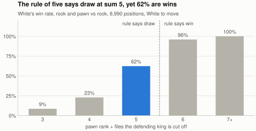

# Do textbook endgame rules hold under perfect play?

Mostly, but they fail at their edges. At sum 5 the rule of five says draw, yet 62% of those
positions are wins. Philidor's defence, followed literally, loses the textbook position. And two
rook pawns win 97.5% of quiet positions with White to move: they are not "often a draw".



## Findings

- **Rule of five** (rook and pawn vs rook, region R5, 8,990 positions, White to move). The rule
  is right in 85.7% (84 false wins, 1,199 false draws). White wins 8.6% at sum 3, 22.9% at 4,
  62.4% at 5, 96.0% at 6 and 100% from 7. Sharpened to "sum 6 or more and the cutting rook below
  the pawn's rank", it claims 3,493 wins, and none is wrong. Its claims fail with the king cut off
  on the short side (103 wrong of 527), with Black to move (295 of 3,493) and for knight pawns
  (42 of 3,789). No short rule is exact: a decision tree on R6 (R5 with the rook not ahead of the
  pawn, 5,300 positions) reaches 91.6% with 2 leaves, 95.0% with 7, 96.8% with 21, 98.1% with 45
  and 99.1% with 75.
- **Philidor** followed literally loses the textbook position `3k4/7R/r7/3PK3/8/8/8/8 b`:
  1...Rb6 2.Rh8+ Kc7 3.d6+ Kd7?? (only 3...Rxd6 draws). This tests the recipe as written: it says
  to step the king when checked, so it misses the free pawn; any player would take it.
- **Rook and two pawns vs rook** (10,592,372,639 legal positions; win rates of quiet positions,
  White / Black to move):
  - Two rook pawns (a+h) win 97.5% / 86.6%; with the Black king blockading a pawn still
    96.0% / 80.2%.
  - Doubled pawns, the Black king cut off one file on the short side (a textbook draw): 59.1%
    wins with White to move. On the long side: 96.7%.
  - f- and h-pawns both on the 6th rank or beyond win 97.9% / 94.7%, but with the Black king in
    front and Black to move only 38% to 73%, by the pawns' ranks.
  - Connected pawns win 95.1% with White to move; doubled pawns with the Black king in front
    12.3%.
  - Pawns with one empty file between them are the hardest pairs: a+c (= f+h) wins 78.5%, b+d
    87.4%, c+e 93.1% with White to move, each below both its neighbours. In real games the
    a+c entry positions are wins in 44.6%, the a+b ones in 79.8% (30,819 games).
- **Safe rules plus search** (king and pawn vs king, 165,676 positions). A sound rule, one that
  never claims a false win, is exact after 21 plies of search. The textbook rule (rule of the
  square and key squares) and the most accurate short rule (93.7%) are wrong in 98 and 875
  positions still at 40 plies; drawing everything needs 38 plies.

## Reproduce

    make data            # once, from the repo root
    make endgames        # about 50 min, one heavy job
    make -C experiments/endgames quick   # the chart from results/, seconds

## Try the checker

A rule file names a material, a region of positions and its rules. A rule says win or draw; a win
claim says win or nothing. The checker counts every legal position of the region with Fathom.

    make -C experiments/endgames slices          # once: build the C part
    cd experiments/endgames
    uv run python check.py rules/rule_of_five.py

```
White to move: 8,990 positions, White wins 84.1%
  rule_of_five    85.7% right: 84 false wins, 1,199 false draws
  sharpened       3,493 claimed wins, 0 wrong
rule_of_five, false win: 2r5/8/8/8/7k/4R3/2P5/1K6 w - - 0 1
...
```

`rules/two_rook_pawns.py` tests "two rook pawns are often a draw":

```
White to move: 89,477,660 positions, White wins 97.5%
  often_a_draw    2.5% right: 0 false wins, 87,265,170 false draws
Black to move: 53,152,025 positions, White wins 86.6%
  often_a_draw    13.4% right: 0 false wins, 46,009,956 false draws
often_a_draw, false draw: 8/8/8/8/8/8/P6P/KRrk4 w - - 0 1
...
```

A policy picks Black's move. `rules/philidor.py` plays Philidor's defence; the checker tries every
White reply until the policy turns the draw into a loss, or proves that it holds:

```
The policy loses: 1...Rb6 2. Rh8+ Kc7 3. d6+ Kd7??
Drawing moves: Rxd6. Positions with Black to move: 391.
```

## Method

- Data: Syzygy WDL tables, enumerated with Fathom one pawn placement at a time (`slices.c`).
  Real games: the Lichess sample (3,178,824 games) and the over-the-board sample (743,828
  games); the first tablebase position of each game.
- Positions count up to the a-h mirror, as on syzygy-tables.info; percentages count every
  position equally. A cursed win counts as a draw (none occur in these tables).
- Rule of five, region R5: a c- to f-pawn on ranks 2-6 protected by its king; the rook cuts the
  black king off on the long side; the black rook on the back rank in front of the pawn; quiet;
  White to move (details in `rules/rule_of_five.py`). The sum is the pawn's rank plus the files
  the king is cut off.
- Quiet: the side to move is not in check and has no capture that leaves the capturing piece
  safe, and no rook is attacked and undefended.
- The rules are quoted via Wikipedia (citing Soltis, Mednis, Emms, Nunn, Müller and Lamprecht).
  The regions and the exact readings are ours; each rule file states its own.
- Policy check: Black follows the policy, White tries every move; a capture or promotion ends a
  line. The policy fails at the first move after which the tablebase says White wins.
- KPvK search: full-width minimax of d plies with the rule at the leaves; a capture or promotion
  ends a line with its tablebase value.

## Limits

- The regions and the formal readings of the rules are ours; a book may mean something narrower.
- The rules are quoted via Wikipedia, not from the books themselves.
- Uniform counts weigh every legal position the same; games reach few of them.
- Real-game rates rest on few games for some pairs (73 for d+d).
