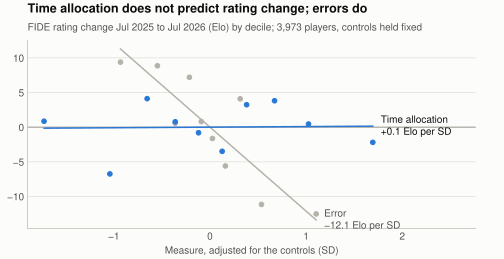

# Does thinking at the right moments make you better?

Not measurably: players who spend their time where it matters most do not gain more rating in the
next year (+0.09 Elo per SD, 95% CI −1.94 to +2.11, 3,973 players).

The test was pre-registered: the analysis was fixed before any rating change or game result was
computed. The positive control works: the error in a player's games predicts rating change
(−12.1 Elo per SD, p < 1e−10). But allocation quality, measured from 6 games, is almost all noise
(split-half reliability 0.043), so the test only excludes true effects larger than about 7 to 13 Elo
a year per SD of true allocation quality.

## Findings

- Reliability of allocation quality: 0.043 (95% CI 0.014 to 0.074), against 0.45 for the mean
  think time and 0.53 for its variability. A reliability of 0.7 would need about 157 games a player.
- On average, stronger players do allocate better: the correlation of think time with the value
  of thinking rises from 0.116 (rating ≤ 1600) to 0.166 (> 2400), as Russek et al. (Cognitive
  Science, 2025) found.
- Within a player, games with better allocation score better: +0.012 points per SD
  (95% CI 0.006 to 0.018, 17,164 games). This is an association only.
- Time is worth more where the value of thinking is high: a low clock (< 10 min) raises the error
  by 0.46 win-% points, and by 0.97 points more (95% CI 0.84 to 1.11) in critical positions (top
  20%), about 3 times as much. But critical moves played fast (< 30 s) hold only 4.8% of all error,
  and they lose less than critical moves played slowly (2.86 against 3.52 win-% points).

## Reproduce

    make data            # once, from the repo root
    make thinking        # about 5 h (Stockfish on 12 cores), then about 10 min
    make -C experiments/thinking quick   # the chart from results/, seconds

`engine.py` skips positions already in `data/thinking/stockfish/`. results/ come from the research's
stored Stockfish run. A new run gives the same best moves and deep scores, but in a few percent of
positions a different score for the shallow move: the research edited its engine script after its run.

## Method

- Data: classical over-the-board games relayed on Lichess in the baseline year (Jul 2024 to
  Jun 2025), with clocks to the second and engine evals on at least 90% of the plies; FIDE standard
  lists of Jul 2024, Jul 2025 and Jul 2026.
- Players: 8,224 with a FIDE ID, at least 10 such games and a rating in the Jul 2025 and Jul 2026
  lists. Analysed: 4,000 of them at random, 6 random games each: 635,837 positions, 501,336 of them
  not decided (|eval| ≤ 300 cp). These two cuts, made for compute, were logged before any outcome.
- Positions: the player's moves 9 to 40 with more than one legal move. Think time = clock before −
  clock after + increment.
- Value of thinking (VOC): the win probability of the best move minus that of the move a depth-4
  search prefers, both scored by a 30,000-node search (Stockfish 19). Win probability: the Lichess
  formula, eval clipped to ±1000 cp.
- Allocation quality (AQ): the Spearman correlation of VOC with log(1 + think time), taken relative
  to the player's mean in that game, over the player's positions.
- Model: OLS with HC3 errors. Rating change (Jul 2025 to Jul 2026) on AQ, with rating, rating²,
  age (linear spline), K-factor, sex, error (mean win-probability loss), score above expectation,
  number of games, mean think time, time-trouble rate and the rating change of the year before.
  Permutation null (think times shuffled within each game, 200 times): p = 0.955.
- Reliability: AQ from odd against even games (3 against 3), bootstrap CI. The bound is the upper
  CI limit divided by the square root of the Spearman-Brown reliability.

## Limits

- VOC is a noisy proxy: the depth-4 and depth-8 versions agree only weakly (Spearman 0.336).
- Only 6 games a player were analysed; true effects up to about 7 Elo per SD a year (13 at the
  low end of the reliability CI) remain possible.
- A game that goes well can change how a player uses time: the within-game link need not be causal.
- Fast moves in critical positions can be prepared opening lines, not careless play.
- Broadcasts over-represent strong events, and relayed clocks are sometimes wrong.
